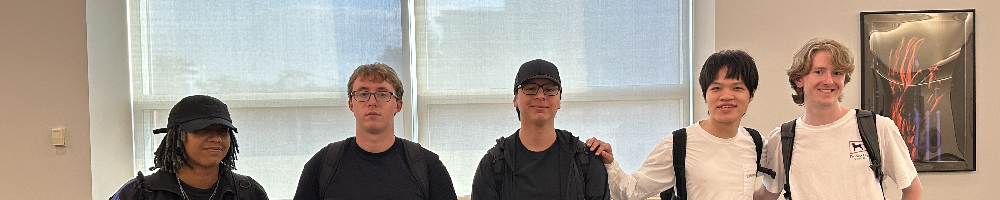

# EC463 Team 22 - Body Heat

**Wireless Wearable for Body Temperature Monitoring During Extreme Heat**

BU ENG EC463/464 Senior Design, 2026-27. Group 22, Group A.

A BLE skin-temperature wearable that flags heat-illness risk from rate-of-rise and reports to a supervisor dashboard.

Replace this image with the team photo: single row, uncluttered background, landscape about 4800x960, 5:1, 72 DPI.

## Team links

[Team Google Drive](https://drive.google.com/drive/u/3/folders/1wxCZ38JLhA3aLCa_SImvz6qaFUtCyiqN)

[Team Board](https://github.com/users/johnnyg00/projects/1)

## Team

Johnny Garcia, @johnnyg00, Team Lead 1, Sep 3 to Oct 4.

Matthew Johnston, GitHub username pending.

Alexander Martinez, GitHub username pending.

Nathan Pearson, GitHub username pending.

Krista Smith, GitHub username pending.

Chengxiao Zhou, GitHub username pending.

## Meeting rhythm, Group A

Workshop: Tuesdays 5:30 to 7:00 PM, PHO 117.

IDR: Thursdays 7:05 PM with Tom, PHO 113, first session 9/10.

Office hours: Tuesday and Thursday 3:30 to 5:15 PM, PHO 113 or PHO 426.

## Repo structure

`hardware/` for schematics, pcb, bom and simulation.

`firmware/` for src, include, lib, tests and build.

`mechanical/` for cad, drawings, 3d_print and renders.

`docs/` for architecture and datasheets.

`scripts/` for flashing and test automation.

Keep `docs/architecture/` current from day one: pin assignments, baud rates and message formats. Last year's teams named integration the hardest part of the project.

## Design constraints

LiPo batteries are banned from the lab and from all projects. Other lithium chemistry needs prior approval, a built-in BMS and a fireproof storage bag. Any battery needs a matching charger, a fuse within inches of the cell, an inline cut-off switch and proper connectors.

Target materials budget is about $1,000.
